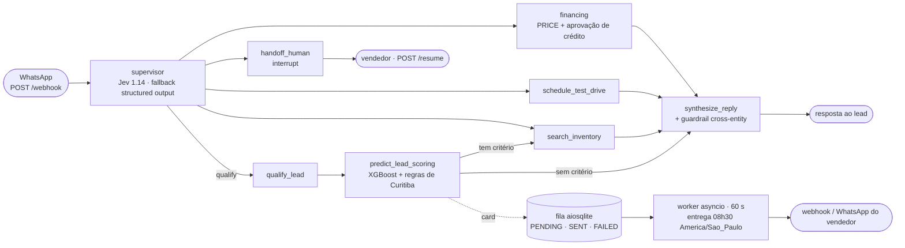

# Dealership Sales Agent

[](https://github.com/maxwellnasci/dealership-sales-agent/actions/workflows/ci.yml)


-brightgreen)


Agente de vendas para **revendas de veículos seminovos**, atendendo leads por
WhatsApp. É um `StateGraph` do **LangGraph** que qualifica o lead, consulta
estoque, simula financiamento, agenda test-drive e transfere para um vendedor
humano — com memória por telefone, números que nunca saem do LLM e um pipeline
de scoring que entrega ao vendedor, às 08h30, um card com a prioridade do lead
e o teto de avaliação do carro da troca.

<p align="center">
  
</p>

<sub>Animação gerada por `scripts/gen_demo_svg.py` a partir de uma conversa real (DeepSeek via OpenRouter).</sub>

---

## O problema

Um assistente de vendas em WhatsApp precisa **lembrar** do lead entre mensagens
fragmentadas, **nunca inventar** preço, parcela ou condição, **chamar um humano**
na hora certa e ser **medido** em custo e qualidade. Do lado da loja, o vendedor
precisa saber **em quem ligar primeiro** e **quanto pode pagar** pelo carro da
troca sem comer a margem.

## Arquitetura



- **Estado**: `GraphState` persistido por `thread_id` (= telefone do lead) via
  checkpointer memory / SQLite / Postgres, com allowlist explícita de tipos.
- **Fronteira de dados**: preços, parcelas, horários e scores só existem como
  modelos Pydantic produzidos por código. O LLM extrai intenção e verbaliza —
  nunca calcula.
- **Isolamento**: o card de scoring é informação do vendedor. Nada do pipeline
  preditivo entra na resposta enviada ao lead (há teste para isso).

Detalhes e *unit economics* do roteamento em [`docs/ARCHITECTURE.md`](docs/ARCHITECTURE.md).

## Defesa anti-alucinação cross-entity

Não basta o número **existir** no estado: ele tem de ser verdade **sobre o
veículo citado**. Antes de enviar, `guardrails/validator.py` fatia a resposta
do LLM por frase e por menção de modelo e amarra cada fato ao seu dono:

| O LLM escreveu | Fatos do turno | Resultado |
|---|---|---|
| "O Corolla sai por R$ 89.900,00" | Corolla R$ 129.900 · Polo R$ 89.900 | ❌ `unverified_amount` — preço do Polo colado no Corolla |
| "Corolla 2023" | Corolla é 2022 | ❌ `unverified_year` |
| "Corolla com apenas 8.000 km" | Corolla tem 38.000 km | ❌ `unverified_mileage` |
| "Também temos um Civic…" | Civic não foi buscado | ❌ `unverified_vehicle` |
| "Test-drive 19/10 às 16h" | Slot reservado: 19/10 às 09h00 | ❌ `unverified_time` (também data, dia da semana e veículo do slot) |
| "O Corolla 2022, 38 mil km, sai por R$ 129,9 mil" | — | ✅ aprovado |

Qualquer flag faz o nó de síntese cair no **rascunho determinístico**, montado
só com fatos das tools. Pior caso: resposta mais seca, nunca um fato mentiroso.
A suíte de regressão prova os dois lados: os bypasses acima falham no
validador antigo, e os rascunhos de **todos** os veículos do catálogo passam
sem falso positivo.

## Pipeline Preditivo de Scoring Tabular (XGBoost) com Calibração de Regras de Negócio e Agendamento Assíncrono

Roda no nó `predict_lead_scoring`, logo após a qualificação, quando o lead
informa um carro na troca (`trade_in` no `/webhook`, com FIPE vinda do
CRM/tabela oficial — nunca extraída pelo LLM). Responde a três perguntas da
mesa de avaliação:

| Pergunta | Como é calculado | Onde |
|---|---|---|
| **O banco aprova o financiamento?** | Spline logístico por faixa de entrada (< 20% · 20–40% · > 40%), score e comprometimento de renda → `credit_approval_prob` e taxa mensal efetiva, que alimenta a parcela PRICE | `mxos_ldm/weights.py::credit_approval`, `tools/financing.py` |
| **Quantos dias o carro da troca fica no pátio?** | Regressor XGBoost (alvo em `log1p(dias)`) ajustado pelo fator de liquidez φ por km/ano do modelo: bônus abaixo de 15 mil km/ano, decaimento exponencial acima e penalização quadrática acima de 25 mil km/ano — o perfil típico de **carro de aplicativo** | `mxos_ldm/model.py`, `mxos_ldm/weights.py::km_liquidity_factor` |
| **Quanto posso pagar pela troca?** | Fórmula fechada, não aprendida: `aquisição = revenda × (1 − 12%) − custos(giro)` — teto em % da FIPE que preserva **12% de margem líquida** dado o giro previsto | `mxos_ldm/model.py::avaliacao_fipe_recomendada` |

Completa o card a **probabilidade de fechamento** (classificador XGBoost sobre
ano, km, FIPE, % da FIPE pedido pelo cliente e % de entrada), que define a
prioridade do lead.

**Decisões que importam:**

- **Dinheiro sai de fórmula auditável, não de caixa-preta.** O ML estima giro e
  propensão; o teto de avaliação é uma conta testada (o teto devolvido,
  aplicado de volta, resulta em exatamente 12% de margem).
- **Sem dupla contagem.** A entrada já é feature do classificador, então a
  aprovação de crédito é exposta à parte em vez de multiplicar a probabilidade
  de fechamento.
- **Fail-closed.** FIPE nula, NaN ou ≤ 0 → `422` na API e card **BLOQUEADO** no
  grafo, sem nenhum valor em reais. Arquivo de pesos ausente ou malformado →
  erro no startup (schema Pydantic strict, `extra="forbid"`).
- **Backends trocáveis.** `xgboost` (padrão quando instalado), `sklearn`
  (HistGradientBoosting) ou `tabpfn` (opcional).

**Agendamento do card (`scheduler/`):**

- Fila durável em SQLite (`aiosqlite`): `PENDING → SENT | FAILED`, idempotente
  por (lead, horário) — recalcular o lead antes das 08h30 atualiza o card, não
  duplica.
- Worker `asyncio` no lifespan da API, tick de 60 s, entrega às **08h30
  America/Sao_Paulo**. Card vencido com o servidor fora do ar sai atrasado, não
  se perde.
- Reivindicação atômica (`PENDING → SENDING`) entre workers; no startup, cards
  presos em `SENDING` voltam à fila. Entrega *at-least-once*: prefere-se um card
  duplicado a um card perdido.
- Retry exponencial via `tenacity` (3 tentativas, esperas de 2 s e 4 s);
  esgotado, `FAILED` com `last_error`. Despacho por webhook (`httpx`) ou mock
  que só loga quando nenhuma URL está configurada.

## Origem dos dados e dos números

O que foi medido e o que é premissa:

| Item | Origem |
|---|---|
| Latência do roteador Jev (~400–600 ms) | Medida na esteira local de validação com `scripts/benchmark_router.py` (3 mensagens de teste, endpoint real do OpenRouter). |
| Custo por decisão do Jev (~US$ 0,000018) | Estimado pelo mesmo script a partir de tokens aproximados (~4 caracteres/token), não por fatura. |
| Pesos de Curitiba (`data/mxos_ldm_weights.json`) | Baseline inicial de calibração a partir de premissas do mercado de seminovos local (polos da Linha Verde e da Mário Tourinho). Ainda não validados contra histórico de vendas. |
| Dataset de treino do XGBoost (`mxos_ldm/data_engine.py`) | **Sintético**: 10.000 negócios gerados com premissas de ordem de grandeza documentadas no código (mix de segmentos, depreciação ~11%/ano, efeito do % FIPE pedido). Serve para exercitar o pipeline de ponta a ponta, não para decisão real. |
| Métricas do modelo no holdout sintético | AUC de fechamento ≈ 0,74; erro médio do giro ~10% abaixo do baseline (mediana). Refletem o gerador, não o mercado. |

## Onde ver cada coisa no código

| Capacidade | Implementação |
|---|---|
| StateGraph, nós e arestas condicionais | `graph/builder.py` |
| Roteamento System-1 (Jev 1.14) com fallback | `graph/router_jev.py` |
| Reducers de estado | `graph/state.py` — `add_messages` + `merge_lead_profile` |
| Checkpointing entre mensagens | `persistence/checkpointer.py` — memory / SQLite / Postgres, allowlist de tipos |
| Human-in-the-loop | `graph/nodes/handoff_human.py` — `interrupt()` + `Command(resume=...)` |
| Tool calling com retry | `tools/inventory.py` (tenacity), `tools/financing.py`, `tools/calendar.py` |
| Anti-alucinação em 3 camadas | `schemas/*` + `_PERSONA` + `guardrails/validator.py` |
| Scoring tabular e regras de Curitiba | `src/mxos_ldm/`, `graph/nodes/predict_lead_scoring.py`, `tools/mxos_ldm.py` |
| Agendador do card das 08h30 | `scheduler/store.py`, `scheduler/worker.py`, `scheduler/notifier.py` |
| Observabilidade (Langfuse) | `observability/tracing.py` — custo + score por conversa |
| Avaliação (LLM-as-judge) | `llm.py::judge` + `tests/test_llm_judge.py` |
| Testes | `tests/` — 332 testes, sem rede e sem API key; 100% de cobertura em `mxos_ldm/` e `scheduler/` |

## Como rodar

### 1. Demo em terminal (offline)

```bash
python -m venv .venv && source .venv/bin/activate
pip install -e ".[dev,ldm]"
python scripts/demo.py
```

Sem `OPENAI_API_KEY`, roda em **fallback determinístico**. Com chave (qualquer
endpoint OpenAI-compatível), as respostas ficam naturais.

### 2. Testes

```bash
pytest           # determinístico: sem rede, sem API key (LLM scriptado)
pytest --cov     # com cobertura (gate de 90% no CI)
ruff check src tests scripts
```

### 3. API (com Postgres)

```bash
cp .env.example .env
docker compose up --build
curl -X POST localhost:8000/webhook -H 'content-type: application/json' \
     -d '{"phone":"+5541999990001","text":"quero um SUV ate 140 mil"}'
```

Handoff: quando o grafo pausa, o `/webhook` devolve `interrupted: true` com o
contexto; o vendedor responde via `POST /resume`.

Para ligar o scoring e o agendador (homologação — ver limitações), no `.env`:

```bash
LDM_ENABLED=true                 # treina o modelo no startup (~1–2 s)
SELLER_WEBHOOK_URL=https://...   # vazio = despacho mock (só loga)
SELLER_WHATSAPP=+5541...
```

```bash
curl -X POST localhost:8000/webhook -H 'content-type: application/json' -d '{
  "phone": "+5541999990001", "text": "quero um SUV ate 140 mil",
  "trade_in": {"ano_modelo": 2023, "km_rodados": 48000, "valor_fipe": 84900,
               "percentual_fipe_pedido": 0.90, "modelo": "Onix"}
}'
```

### 4. Benchmark de roteamento (Jev vs. LLM generativo)

```bash
python scripts/benchmark_router.py
```

| Por decisão de rota | LLM generativo (`structured_output`) | System-1 (`typesafe/jev-1.14`) |
|---|---|---|
| Latência | ~800–1.500 ms | **~400–600 ms** |
| Custo (estimado) | ~US$ 0,00015+ | **~US$ 0,000018** |
| Probabilidade calibrada | não nativa | sim (`probabilities` + `confidence`) |
| Sem API key / erro | `TemplateLLMClient` | degrada para o roteador clássico |

Origem dos números na seção [Origem dos dados e dos números](#origem-dos-dados-e-dos-números).

## Decisões de projeto

- **System-1 / System-2.** Rota decidida por um classificador dedicado, barato
  e rápido; cálculos financeiros, de estoque e de avaliação em Python
  determinístico; LLM generativo só para extração semântica e para humanizar a
  resposta final.
- **Ports & adapters.** O grafo recebe `LLMClient`, `LDMPredictor`, `CardStore`
  e `Notifier` injetados, não SDKs. Por isso a suíte inteira roda sem rede, em
  ~5 s.
- **Memória = checkpointer por `thread_id`.** Trocar SQLite ↔ Postgres não muda
  uma linha do grafo.
- **Falhar fechado.** Dado crítico ausente bloqueia a saída (avaliação, card,
  pesos) em vez de produzir um número plausível e errado.

## Limitações conhecidas e próximos passos

- **Treino sintético.** O XGBoost aprende com dados gerados por premissas; por
  isso `LDM_ENABLED=false` por padrão. Próximo passo: plugar o pipeline em
  telemetria real de CRM (negócios fechados/perdidos, dias de pátio, preço de
  revenda) e re-treinar.
- **Pesos de Curitiba sem validação empírica.** Precisam ser comparados com o
  histórico de vendas antes de orientar a mesa de avaliação.
- **Duas metas de margem.** O teto de avaliação mira 12% de margem líquida; a
  regra de mesa em `tools/mxos_ldm.py` usa mínimos de 7,5–8,5% por polo.
  Precisam convergir para uma política única.
- **Perfil de crédito fixo.** Score 650 e comprometimento de renda de 28% para
  todos os leads, e entrada assumida em 20% no nó de scoring — a conversa ainda
  não coleta esses dados.
- **Agendador.** Entrega também em fins de semana; webhook sem autenticação;
  cards `FAILED` ficam registrados, mas não há reprocessamento automático.

## Licença

Distribuído sob a licença **MIT** — veja [`LICENSE`](LICENSE).
