# Dealership Sales Agent

[](https://github.com/maxwellnasci/dealership-sales-agent/actions/workflows/ci.yml)

-brightgreen)
-brightgreen)


Agente de vendas para **revendas de veículos**, atendendo leads por WhatsApp.
Construído com **LangGraph** como uma máquina de estados de qualificação de
lead — conversas naturais, confiáveis, com custo e qualidade mensuráveis.

> Capacidades: StateGraph com arestas condicionais, roteamento **System-1 Jev**
> (`typesafe/jev-1.14`), checkpointing de memória entre mensagens,
> human-in-the-loop (`interrupt`), tool calling com retry e anti-alucinação
> com Pydantic.

<p align="center">
  
</p>

<sub>Animação gerada por `scripts/gen_demo_svg.py` a partir de uma conversa real (DeepSeek via OpenRouter).</sub>

---

## Por que ele existe (a dor)

Um assistente de vendas precisa **lembrar** do lead entre mensagens
fragmentadas de WhatsApp, **nunca inventar** preço ou condição, saber **chamar
um humano** na hora certa, e ser **medido** (custo e qualidade). Este repo é uma
implementação enxuta e testada desses quatro pilares.

## Arquitetura em 30 segundos

```
WhatsApp ─► supervisor (System-1 Jev 1.14 / structured output fallback)
                │  (~400-600ms | US$ 0.000018/decisão | p calibrada)
     ┌──────────┼───────────┬──────────────┬─────────────┐
     ▼          ▼           ▼              ▼             ▼
 qualify   search_      schedule_     financing     handoff_human
 _lead     inventory    test_drive    (PRICE)       (interrupt → vendedor)
     └──────────┴───────────┴──────────────┘             │
                     ▼                                    │
             synthesize_reply ──► guardrail anti-alucinação ──► END
```

Detalhes, *unit economics* e justificativas em [`docs/ARCHITECTURE.md`](docs/ARCHITECTURE.md).

## Defesa anti-alucinação cross-entity

Não basta o número **existir** no estado: ele tem de ser verdade **sobre o
veículo citado**. Antes de enviar, `guardrails/validator.py` fatia a resposta
do LLM por frase e por menção de modelo e amarra cada fato ao seu dono:

| O LLM escreveu | Fatos do turno | Resultado |
|---|---|---|
| "O Corolla sai por R$ 89.900,00" | Corolla R$ 129.900 · Polo R$ 89.900 | ❌ `unverified_amount` — preço do Polo colado no Corolla |
| "Corolla 2023" | Corolla é 2022 | ❌ `unverified_year` |
| "Corolla com apenas 8.000 km" | Corolla tem 38.000 km | ❌ `unverified_mileage` |
| "Também temos um Civic…" | Civic não foi buscado | ❌ `unverified_vehicle` |
| "Test-drive 19/10 às 16h" | Slot reservado: 19/10 às 09h00 | ❌ `unverified_time` (também data, dia da semana e veículo do slot) |
| "O Corolla 2022, 38 mil km, sai por R$ 129,9 mil" | — | ✅ aprovado |

Qualquer flag faz o nó de síntese cair no **rascunho determinístico**, montado
só com fatos das tools. Pior caso: resposta mais seca, nunca um fato mentiroso.
A suíte de regressão prova os dois lados: os bypasses acima falham no
validador antigo, e os rascunhos de **todos** os veículos do catálogo passam
sem falso positivo.

## Pilares (e onde ver no código)

| Pilar | Implementação |
|---|---|
| **StateGraph / nós / arestas condicionais** | `graph/builder.py` |
| **Roteamento System-1 (Jev 1.14)** | `graph/router_jev.py` — `typesafe/jev-1.14` (`/api/alpha/decisions`) + probabilidade calibrada e fallback automático |
| **Reducers de estado** | `graph/state.py` — `add_messages` + `merge_lead_profile` (merge incremental com detecção de mudança de modelo) |
| **Checkpointing entre mensagens** | `persistence/checkpointer.py` — memory/sqlite/postgres, `thread_id` = telefone, serializer com allowlist explícita de tipos |
| **Human-in-the-loop (interrupt)** | `graph/nodes/handoff_human.py` — `interrupt()` + `Command(resume=...)` |
| **Tool calling com retry** | `tools/inventory.py` (tenacity); `tools/financing.py`, `tools/calendar.py` |
| **Anti-alucinação em 3 camadas** | `schemas/*` (estrutural) + `_PERSONA` + `guardrails/validator.py` (preço/ano/km amarrados ao veículo citado; data+hora do slot) |
| **Scoring preditivo (mxos_ldm)** | `graph/nodes/predict_lead_scoring.py` + `src/mxos_ldm/` — probabilidade de fechamento, giro do carro da troca, teto de avaliação (margem líquida 12%) e Card Executivo das 08h30; fail-closed sem FIPE |
| **Suíte determinística (275 testes, 98% de cobertura, gate de 90% no CI)** | `tests/` — tudo `async`, perfis/tools tipados, zero rede e zero API key |
| **Observabilidade (Langfuse)** | `observability/tracing.py` — custo + score por conversa |
| **Avaliação (LLM-as-judge)** | `llm.py::judge` + `tests/test_llm_judge.py` |

## Como rodar

### 1. Demo em terminal (zero setup, roda offline)

```bash
python -m venv .venv && source .venv/bin/activate
pip install -e ".[dev]"
python scripts/demo.py
```

Sem `OPENAI_API_KEY`, roda em **fallback determinístico**. Com chave (qualquer
endpoint OpenAI-compatível), as respostas ficam naturais.

### 2. Testes (275 testes determinísticos)

```bash
pytest           # rápido, sem rede, sem API key — usa LLM scriptado
pytest --cov     # com cobertura (gate de 90% no CI)
```

### 3. API (produção-like, com Postgres)

```bash
cp .env.example .env            # ajuste o que quiser
docker compose up --build
curl -X POST localhost:8000/webhook -H 'content-type: application/json' \
     -d '{"phone":"+5541999990001","text":"quero um SUV ate 140 mil"}'
```

Handoff: quando o grafo pausa, o `/webhook` devolve `interrupted: true` + o
contexto; o vendedor responde via `POST /resume`.

### 4. Benchmark de Roteamento (System-1 Jev vs. LLM Generativo)

Em vez de gastar uma chamada generativa completa (`/chat/completions`) apenas
para decidir a rota do turno, o adaptador [`JevRouter`](src/dealership_agent/graph/router_jev.py)
utiliza o modelo de decisão **`typesafe/jev-1.14`** via endpoint
`/api/alpha/decisions` do OpenRouter, retornando distribuição de probabilidades
calibrada e fallback transparente:

```bash
python scripts/benchmark_router.py
```

| Métrica por Decisão de Rota | LLM Generativo (`structured_output`) | System-1 Decision (`typesafe/jev-1.14`) |
|---|---|---|
| **Latência média** | ~800 – 1.500 ms | **~400 – 600 ms** |
| **Custo médio por decisão** | ~US$ 0.00015+ | **US$ 0.000018** (~55 decisões por US$ 0.001) |
| **Confiança calibrada (`p`)** | Não nativo | **Sim (`probabilities` + `confidence` 0..1)** |
| **Resiliência sem API key / erro** | Fallback `TemplateLLMClient` | **Degradação graciosa para o roteador clássico** |

## Scoring preditivo (mxos_ldm)

Depois de `qualify_lead`, o nó `predict_lead_scoring` roda o LDM quando o lead
tem carro na troca (`trade_in` no `/webhook`, com FIPE vinda do CRM/tabela
oficial — nunca extraída pelo LLM):

- **probabilidade de fechamento** (0-100) e **giro estimado** do carro da troca
  (XGBoost; `auto` cai em scikit-learn; TabPFN opcional);
- **teto de avaliação** em % da FIPE por fórmula fechada de margem líquida 12%;
- **pesos de liquidez da Matriz de Curitiba** (`data/mxos_ldm_weights.json`,
  formato em `mxos_ldm/weights.py`): km/ano > 15 mil e faixas de entrada
  < 20% / > 40%. Sem o arquivo, os pesos são neutros;
- **Card Executivo** em `seller_briefing_card`, agendado para as 08h30.

Tudo persiste no checkpoint (tipos na allowlist) e **nada disso chega à
resposta do lead**. FIPE nula/NaN/zero: 422 na API e card BLOQUEADO no grafo.

> ⚠️ O modelo ainda é treinado em dataset **sintético** (`data_engine.py`).
> Por isso `LDM_ENABLED=false` por padrão — ligar só em homologação até plugar
> o histórico real da revenda.

## Decisões de projeto

- **Arquitetura Híbrida System-1 / System-2**: decisão de rota ultrarrápida e
  barata via modelo classificatório dedicado (`typesafe/jev-1.14`), cálculos
  financeiros e de estoque 100% determinísticos em Python puro (Tabela PRICE), e
  LLM generativo reservado exclusivamente para extração semântica e humanização
  da resposta final.
- **Ports & adapters no LLM** (`llm.py` + `graph/router_jev.py`): o grafo
  depende de uma interface `LLMClient`, não da SDK. Produção usa `JevRouter` +
  `with_structured_output` do LangChain; testes usam um cliente scriptado →
  suíte de testes determinística, grátis e sem rede.
- **Anti-alucinação em três camadas**: estrutural (preços só vêm de tools
  tipadas) + persona restritiva sobre rascunho factual + validação do texto
  final contra os fatos **de cada entidade citada** — modelo, ano, km e preço
  amarrados ao mesmo veículo (`guardrails/validator.py`). Pior caso = resposta
  mais seca, nunca um fato mentiroso.
- **Memória = checkpointer por `thread_id`**: trocar SQLite↔Postgres não muda
  uma linha do grafo.

## Licença

Distribuído sob a licença **MIT** — veja [`LICENSE`](LICENSE) para o texto completo.
